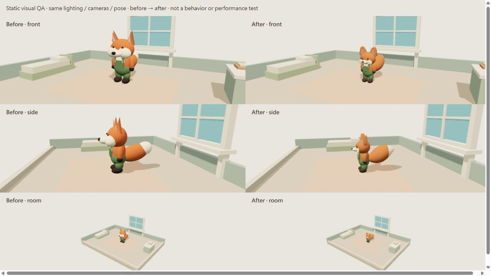

# V0.1 — 有限角色 Visual Refinement

日期：2026-09-10；branch `feature/v0.1-vertical-slice`，未提交 working tree。唯一產品程式變更為 `src/createFoxVisual.ts`。不含 Blender、外部資產、新依賴或 V0.2。

## 比例與空間

| 靜態中立姿勢；世界單位 | Before | After |
| --- | --- | --- |
| 寬度（包含手臂／耳朵的 AABB） | 1.026 | 0.728 |
| 含耳高度 | 1.862 | 1.292（-30.6%） |
| 深度（含口鼻／尾巴） | 1.912 | 1.447 |
| 身高／床長 1.9 | 98.0% | 68.0% |
| 身高／床墊頂高 0.48 | 3.88 | 2.69 |

只將 visual child 縮為 0.76 倍，另調整局部頭／身／耳比例；並非把世界座標或 Camera 縮放。頭身按「腳底至頭頂、不含耳」1.44 ÷ 頭高 0.60 = **2.4 頭身**計算。房間維持 8.4×6.4；床長 1.9、寬 0.85；窗戶、站位 (0,0,-1.4)、相機設定保持原值。縮小後窗前角色與窗台的高度關係已在 production Observe 畫面檢查，是否符合 PO 的觀看感受仍待本人確認。

## 外觀修正

- 頭保留偏大，頭部橢球由 0.43×0.345×0.33 改 0.375×0.30×0.305（半徑）；身體收窄、縮短，綠色吊帶褲保留。
- 耳朵由尖銳三面錐體改為有厚度、圓角的短三角輪廓；內耳用柔和低飽和色。
- 眼睛由 0.045×0.057 改 0.028×0.038；移除獨立白色亮點。原模型沒有獨立眉毛，本次維持無眉毛，不新增表情零件。
- 白色臉頰縮小且壓薄；口鼻由 0.19×0.12×0.22 收至 0.135×0.085×0.175，鼻子縮小，降低鼓腮吉祥物感。
- 尾巴由兩顆重疊橢球改成單一連續漸尖曲面；較寬腹部、向上延伸的輪廓、同曲面的奶油色末段。相對身體更大，絕對尺寸仍配合整體縮小。
- 肩膀向內、上臂與身體重疊更自然，褲管延伸到腳踝；圓角胸兜與肩帶降低方塊拼接感。仍是程序化 primitive placeholder，未宣称無接縫正式模型。
- 橢球細分從 16×12 調至 24×18，保留 roughness 0.9～1 的非金屬霧面，橘毛／奶油白／深色五官更柔和；沒有外部貼圖或 shader 系統。

## 行為與验证

與上一輪 manifest 比對，Character、scene、main、WindowInteraction、DebugPanel、FrameClock、PerformanceSample、styles、package／lockfile 與 tests hashes 全部不變。動畫方法、步態頻率、State、速度、轉向、Observe 4 秒、Camera、互動和測試架構保持原有內容。外觀縮放會縮小微動畫的世界幅度與角色 raycast 幾何；窗戶拾取、角色中心路徑與計時不變。

- typecheck：exit 0。
- tests：9 passed、0 failed，179.0894 ms；包含三起點 Observe 完整流程、重複指令、背景時間、幾何通行空間及 Raycaster。
- build：exit 0，16 modules、144 ms；JS `index-B0gSM-OD.js` 596.34 kB／gzip 152.24 kB。上一版 567.82／143.29 kB；Three.js 既有 RoundedBoxGeometry 引入的建置體積增加已如實保留，>500 kB 警告仍在。
- production smoke：In-app Browser，1280×720，`127.0.0.1:4176`。實際點窗進 Walk to window、捕捉 Observe，再確認 Idle／Autonomous／target None；之後自主生活可繼續。Debug 隱藏、環繞、重設可操作，重設後 hits 仍為 2。捕捉的 Console error／warning 為空。
- 此次未量測 FPS；上述 smoke 不等於獨立 Chrome、AC-09 background-tab 或 AC-11 PO 驗收。原 60.40 秒／1.19 FPS 僅為受限環境歷史紀錄。

## Before／After 與證據

同光線、同鏡頭、同中立姿勢的正面／側面／房間對照；這是靜態 QA 場景，不是行為演出截圖。左為修改前，右為修改後。QA 頁僅由 dev 提供，不列入 production entry。

- [Production Observe 截圖](evidence/v0.1-visual/production-observe.png)
- [Smoke 原始狀態與 Console](evidence/v0.1-visual/smoke.json)
- [重跑完整輸出](evidence/v0.1-visual/verification.json)
- [尺寸與來源 hashes](evidence/v0.1-visual/geometry-and-source.json)
- [修改前來源快照](evidence/v0.1-visual/createFoxVisual.before.ts)（原樣保存，僅 QA）
- [對照頁來源](evidence/v0.1-visual/comparison.html)：執行 dev 後開 `/docs/evidence/v0.1-visual/comparison.html`。

本輪停止於外觀微調；PO 是否接受狐狸 silhouette、Cozy 氣質與遠景可讀性仍待實際體驗。不 push、不 merge。
